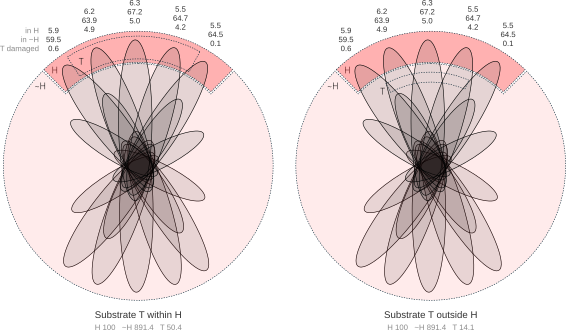

<p align='center'>
    

</p>


# *HypoSubstrateTesting*
Testing hypothesized neural substrates with lesions

## ABOUT

This code has been developed by the High Dimensional Neurology group at the [Queen Square Institute of Neurology UCL](https://www.ucl.ac.uk/brain-sciences/ion).

Authors: <br>
[Patrik Bey](https://github.com/PatrikBey) <br>
Parashkev Nachev


### INPUT REQUIREMENTS
The framework assumes the following file structure:

```bash
DATA_DIR
    |_LESIONS
        |_sub-0001_lesion.nii
        |_sub-0002_lesion.nii
    |_MASKS
        |_substrate_mask_1.nii
        |_substrate_mask_2.nii
```

### SOFTWARE REQUIREMENTS
1. Matlab
2. SPM
3. BASH (optional for automated run script usage)

### USAGE

To run the full framework 'run_framework.sh' can be used to include all steps of the pipeline.
Steps of the pipeline include:

1. lesion mask processing
2. lesion morphology computation
3. substrate-based synthetic behaviour computation
4. MCMC simulations
5. model-based visualisation
6. summary visualisation

```bash
# run from the repository root
export LESION_DIR=/PATH/TO/LESIONS
export MASK_DIR=$(pwd)/data/MASKS
export BRAIN_MASK=$(pwd)/data/mni_brain_mask.nii.gz
export SPM_PATH=/PATH/TO/spm
export MATLAB_CMD=/PATH/TO/MatlabR2025b/bin/matlab
export OUT_DIR=/PATH/TO/RESULTS
export MAX_JOBS=16

bash ./code/run_framework.sh
```


## REFERENCES
Patrik Bey, Joe Mole, James K. Ruffle, Amy Nelson, Edgar Chan, Parashkev Nachev, and Lisa Cipolotti, Testing hypothesized neural substrates with lesions, (2026), *under review*