    

# *HypoSubstrateTesting*
Testing hypothesized neural substrates with lesions

## ABOUT

This code has been developed by the High Dimensional Neurology group at the [Queen Square Institute of Neurology UCL](https://www.ucl.ac.uk/brain-sciences/ion).

Authors: \
Parashkev Nachev; p.nachev (at) ucl.ac.uk
Patrik Bey; patrik.bey (at) ucl.ac.uk

## REFERENCES
Patrik Bey, Joe Mole, James K. Ruffle, Amy Nelson, Edgar Chan, Parashkev Nachev, and Lisa Cipolotti, Testing hypothesized neural substrates with lesions    